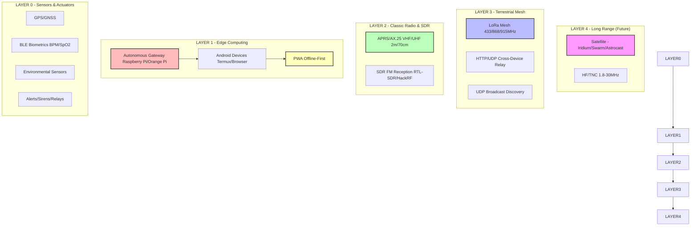

# Architecture Simplified - Lifeline Core

## Overview

Lifeline Core uses a layered architecture designed for maximum resilience in disaster scenarios. Each layer provides redundancy and can operate independently if upper layers fail.

## Layered Architecture

## Layer Descriptions

| Layer | Purpose | Components | Status |
| --- | --- | --- | --- |
| **Layer 0** | Sensors & Actuators | GPS, accelerometer, barometer, BLE biometrics, environmental sensors, alert actuators | **Implemented** - Real sensor integration from Android devices |
| **Layer 1** | Edge Computing | Android smartphones/tablets, autonomous gateways (RPi/OrangePi), PWA | **Implemented** - Runs on any Android device via browser/Termux |
| **Layer 2** | Classic Radio & SDR | APRS/AX.25 on VHF/UHF, SDR reception (RTL-SDR/HackRF) | **Implemented** - Full protocol support |
| **Layer 3** | Terrestrial Mesh | LoRa mesh networking, cross-device relay, automatic discovery | **Implemented** - Decentralized mesh with store-and-forward |
| **Layer 4** | Long Range (Future) | Satellite (Iridium SBD/Swarm/Astrocast), HF radio (1.8-30 MHz) | **Planned** - Architecture ready for integration |

## Key Design Principles

- **Offline-First:** No dependency on internet or cellular connectivity
- **Decentralized:** No central server or single point of failure
- **Zero Fake Data:** Sensors only report real readings; unavailable data shows as `—` or `null`
- **Android-First:** Optimized for the most accessible devices in vulnerable regions
- **Low-Cost:** Replicable with commodity hardware and repurposed devices
- **Open Source:** MIT licensed for maximum adoption and transparency
- **Security by Design:** AES-128 encryption for mesh communications
- **Graceful Degradation:** System continues to function as components fail

## Core Components

| Component | Location | Function |
| --- | --- | --- |
| **Packet Encoder** | `radio/packet_encoder.js` | CBOR+LZ77+AES-CTR encryption with MIC |
| **LoRa Mesh** | `radio/lora_mesh.js` | Mesh routing, beacons, and multi-hop delivery |
| **APRS Protocol** | `radio/aprs_protocol.js` | AX.25 packet radio for VHF/UHF |
| **Lifeline Engine** | `simulation/simulation/lifeline_engine.js` | Core orchestration, role classification, alert management |
| **Relay Adapter** | `simulation/simulation/relay_adapter.js` | Cross-device communication without central server |
| **PWA Service Worker** | `simulation/simulation/sw.js` | Offline caching for app shell |
| **Autonomous Gateway** | `simulation/simulation/server.js` | Wi-Fi AP gateway with discovery and relay |

## Data Flow

1. **Local Sensing:** Android device collects real sensor data (GPS, motion, biometrics)
2. **Local Processing:** Lifeline Engine classifies role, assesses situation, generates alerts
3. **Encryption:** Packets encrypted with AES-128 before transmission
4. **Mesh Routing:** LoRa mesh finds optimal path to destination through relay nodes
5. **Cross-Device Sync:** Devices discover each other via UDP broadcast and sync over HTTP/WebRTC
6. **Store-and-Forward:** If destination unavailable, DTN stores and forwards when path exists
7. **Multi-Transport Fallback:** System switches to available transport (Wi-Fi, WebRTC) if LoRa unavailable

## Deployment Models

| Model | Use Case | Requirements |
| --- | --- | --- |
| **Solo Device** | Individual monitoring and alerts | Android phone + browser/Termux |
| **Local Network** | Small team coordination | Multiple devices on same Wi-Fi (ad-hoc or gateway) |
| **Mesh Network** | Extended range coverage | Devices with LoRa radios in mesh topology |
| **Autonomous Gateway** | Community hub | Raspberry Pi + LoRa radio + power (solar/battery) + Wi-Fi AP |

For detailed deployment instructions, see [DEPLOY_GATEWAY.md](../DEPLOY_GATEWAY.md).
